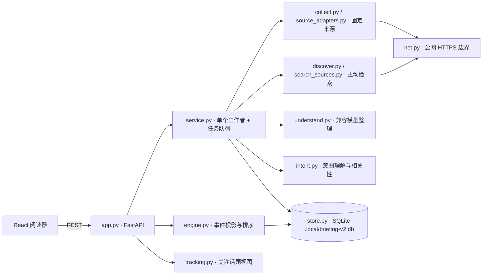

# 架构

本机单用户的 Python / React 应用。运行时代码只有 `backend/northing_signal/briefing/` 一个包和 `frontend/src/` 下的阅读器页面。产品行为与证据规则见 [内容引擎说明](CONTENT_ENGINE.md)，来源见 [来源接入说明](SOURCES.md)。

| 模块 | 职责 |
|---|---|
| `app.py` | HTTP 路由、本机来源校验、静态页面 |
| `service.py` | 刷新、检索、话题追踪共用一个工作者和任务队列；取消后不发布迟到结果 |
| `store.py` | 独立 SQLite 文件：素材版本不可变，阅读操作只追加 |
| `collect.py`、`source_adapters.py` | 固定来源（RSS、官网列表、开源版本、模型目录、榜单）采集与正文补读 |
| `discover.py`、`search_sources.py` | 用户发起或追踪方案触发的公开检索；搜索摘要只作线索 |
| `net.py` | 公网读取边界：只允许 HTTPS，连接固定到已校验的公网 IP，按原域名校验 TLS，限制重定向和响应大小 |
| `understand.py` | 调用兼容 Chat Completions 接口整理素材；校验引文、数字与结构；记录用量与预算 |
| `intent.py` | 自然语言描述 → 可核对的追踪方案 → 方案内的相关性判断 |
| `engine.py` | 纯函数：事件聚合、阅读排序、简报选取；不依赖 HTTP 或数据库 |
| `events.py` | 纯函数：新材料归入哪个事件（原文相同、框架相同、保守的模糊匹配）与合并别名解析 |
| `tracking.py` | 关注话题的成员与未读版本计算 |
| `models.py`、`settings.py` | 数据契约与配置 |
| `__main__.py` | 命令行：离线检查、导出、重查与有界采集 |

前端：`ReaderApp.tsx` 负责页面与交互；`reader/types.ts` 是 `/api/reader` 返回数据的类型；`reader/logic.ts` 放不依赖 React 和浏览器的纯函数（路由、列表划分、证据标签），由 `frontend/tests/` 覆盖。

版本号只写在 `backend/northing_signal/__init__.py`，`pyproject.toml`、API 和 `/api/health` 都从这里读取。

## 不变量

1. 素材版本写入后不改；同一版本的出处字段不同会拒绝写入。
2. 收藏、反馈、已了解等操作只追加，撤回也是一条新记录。
3. 取消任务后，迟到的模型结果不写入、不发布。
4. 追踪方案经用户确认后才会检索；修改范围需要重新确认。
5. `baseline` 模式不调用模型，也不用关键词规则冒充模型判断。
6. 引文必须能在原文中连续找到；数字必须出现在原文中。

## 数据层

- **迁移**：`store.MIGRATIONS` 按编号顺序执行，当前版本记在 `meta.schema_version`。升级已有数据库前，先用 SQLite backup 复制一份 `briefing-v2.db.bak-v<旧版本>`；遇到比程序更新的数据库会拒绝启动。新增结构只能追加新的编号，不能修改已经执行过的迁移。
- **修订号**：触发器在 `meta` 中维护两个计数器。`content_revision` 跟踪素材和判断，`reader_revision` 跟踪交互、偏好、关注和意图判断。其他进程（如命令行）的写入同样会更新。
- **缓存**：`ContentService.projection()` 缓存事件投影、收藏与关注视图，修订号变化或超过 10 分钟后重新计算。超时是为了让时间衰减排序不在空闲时冻结。`Store.materials()` 按内容修订号缓存解析结果。
- **交互校验**：`record_interaction()` 只依赖内容和收藏集合，所以高频的"已展示""已打开"不会触发完整投影。
- **快照**：只保存当时简报的 focus/radar 事件，不保存整个资料库。保留最近 60 份，以及 90 天内的全部快照。
- **线程**：路由和后台任务中的大块读取与投影计算放在线程中执行；`Store` 用一把锁串行访问 SQLite。
- **规则代**：判断表的主键是 `(version, policy, epoch)`。`judgments()` 对每个版本取 epoch 最高、写入最晚的一条。启动时 `adopt_policy()` 把当前提示词在迁移前写下的判断认领为当前规则代；其他提示词版本写下的判断保持 epoch 0，不显示。`POLICY_EPOCH` 只在判断结论应当失效时才提升（`models.py`）。
- **事件归属**（schema 4）：`event_members` 按材料 id 记录所属事件，分配后不再自动移动；`event_aliases` 记录合并前的旧 ID，`event_changes` 追加记录读者的拆分与合并。首次启动时按原有投影规则回填（`meta.events_backfilled`），保证事件 ID 不变。`project()` 接收归属后按它分组，未分配的材料仍按原规则计算。阅读操作按版本所属的材料归到当前事件。
- **更新记录**（schema 5）：`refreshes` 记录每次简报更新（手动或定时）的开始、结束和状态，带修订触发器。投影以最近一次完成的更新为界计算“新 / 有更新”，并让此后标记的“已了解”只在下次更新时移出重点。`ContentService.refresh_due()` 在追踪循环中每 30 秒检查一次 0 点 / 12 点时段，作为非手动任务排队。
- **失败退避**：`judgment_failures` 按 `(version, epoch)` 记录尝试次数、原因和下次重试时间（1 小时、6 小时，第三次后停止；引文/数字不符从第二级开始）。判断成功或调用 `/materials/{version}/retry` 后清除记录。

## 任务队列

刷新、主动检索和话题追踪由一个工作者依次执行（`ContentService.submit`）。忙碌时新任务进入队列，最多 8 项：手动任务排在定时追踪之前；同一次刷新、同一个话题不会重复排队。`POST /api/reader/cancel` 不带参数时停止当前任务，带 `{"id": ...}` 时停止当前任务或移出某个排队任务；暂停、删除或修改话题方案时，会一并取消它排队中和执行中的检查。当前任务结束或被取消后，队列自动继续。

一次任务内，模型请求按 `READER_BATCH_SIZE` 分批，最多 `READER_MODEL_CONCURRENCY` 个请求同时进行（内容整理与意图判断共享这一限制）。没有额度、没有配置模型或供应商请求失败时，本轮停止后续请求。

## 有意保留的简化

单进程、单个工作者，适合本机使用。队列只在内存中，服务重启后排队中的任务不保留（定时追踪会按间隔重新排入）。数据变化后的首次投影仍是全量计算（5000 条素材约 1.4 秒，在线程中执行）。尚未实现：向量检索、用户鉴权和多用户隔离。

## 历史

2026-10 的 0.2 目标工作台和 G1–G4 研究、评测、审计材料已于 2026-11-10 从主分支移除，保存在 `archive/research-g1-g4` 分支和 `archive/g1-g4-final` 标签。旧个人数据库可用 `scripts/export_legacy.py` 只读导出。最初从比赛项目迁入的资产及其字节校验记录见 [MIGRATION.md](MIGRATION.md) 和 `docs/provenance/`。
